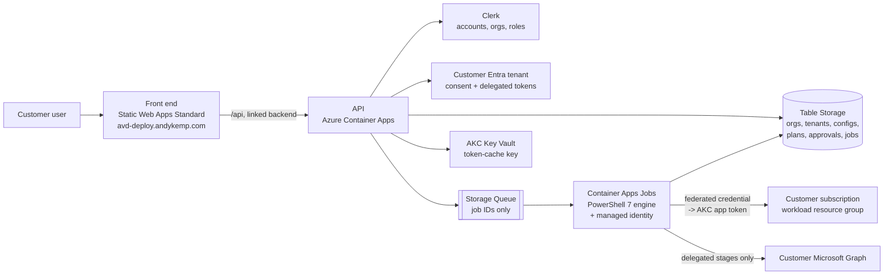

# Hosted self-service: design

Status: proposed. Date: 2026-10-16. Decisions: [ADR 0017](adr/0017-hosted-multi-tenant-service.md) (hosted service), [ADR 0018](adr/0018-accounts-and-tenant-connection.md) (Clerk accounts and tenant connection), [ADR 0019](adr/0019-cross-tenant-execution.md) (cross-tenant execution).

Andy Kemp Consulting (AKC) hosts the portal. A customer signs up, connects their Microsoft tenant and builds their own AVD estate in their own subscription. The existing PowerShell engine, contract and Bicep do the deployment; the hosted layer adds accounts, tenant connection, a job queue and a UI.

## Customer journey

1. **Sign up** at `avd-deploy.andykemp.com`, or just sign in with an existing andykemp.com account (the same Clerk instance as AKC's other apps). Create or choose an organisation and request AVD for it. During the private beta AKC approves the organisation, and the requester becomes its first AVD Admin ([ADR 0018](adr/0018-accounts-and-tenant-connection.md)). They then invite colleagues as reader, operator, approver or admin.
2. **Connect tenant** (organisation admin, once). A customer Global Administrator or Cloud Application Administrator approves the "AKC AVD Deploy" app on the admin consent page. The portal records the tenant against the organisation.
3. **Link Microsoft account** (each operator, once). Sign in with your own work account in that tenant.
4. **Onboard a subscription** (someone with Owner on it, once per subscription). The portal shows exactly what it will do, then, as that person:
   - registers the resource providers AVD needs;
   - creates the workload resource group;
   - grants the AKC app Contributor and a constrained RBAC Administrator role on that resource group only;
   - assigns *Desktop Virtualization Power On Off Contributor* to the Azure Virtual Desktop service principal at subscription scope, if scaling will be used.
5. **Design the desktop.** The existing wizard questions: shared or dedicated, persona, users, concurrency, hybrid or cloud-only identities, scaling, network, groups, names. Dropdowns are filled from the operator's own delegated discovery.
6. **Preview.** A what-if runs as the operator and produces a plan with blockers, warnings, cost estimate and the post-deploy changes that will need confirmation.
7. **Approve.** An approver (or the operator, if the organisation allows self-approval) approves the exact plan.
8. **Deploy.** A queued job runs as the AKC app: foundation, platform, registration token, session hosts, token revocation, registration check, Kerberos restart, host assignment. The user can close the browser.
9. **Finish setup.** The operator reviews and confirms the tenant-level changes (Entra RDP authentication, storage app consent, Conditional Access exclusion), which run as a short delegated job, followed by folder permissions and the device check.
10. **Report.** Done items, remaining manual tasks and a "test sign-in" checklist. Later: **Add capacity**, **Add dedicated user**, **Repeat this deployment**.

## Architecture

| Component | Choice | Notes |
| --- | --- | --- |
| Front end | Azure Static Web Apps (`swa-avddeploy-portal`, currently Free; move to **Standard** for the linked API) | Static TypeScript/React build with Clerk's front-end SDK. Follows the www.andykemp.com look and feel: coppersite's design tokens (`src/styles/global.css`), light by default with the same `akc-theme` dark toggle, AKC logo header, and a Clerk `appearance` built from those tokens so sign-in and the user menu match. [portal/web/index.html](../portal/web/index.html) is the reference. |
| API | TypeScript (Node) on Azure Container Apps, linked to the Static Web App as its backend so `/api` is same-origin | Standard plan required for linking. The API validates the Clerk bearer token itself; it never trusts Static Web Apps identity headers. Linked APIs have a 45-second request limit, so anything longer becomes a job. Clerk and MSAL Node SDKs are first-class. |
| Accounts | The existing andykemp.com Clerk production instance for sign-in and organisations (membership optional); AVD roles stored in the control plane | Tokens verified with `authorizedParties` pinned to the AVD origin. Sensitive actions need a fresh MFA sign-in to the linked work account. No paid Clerk features. [ADR 0018](adr/0018-accounts-and-tenant-connection.md) |
| Domain | `avd-deploy.andykemp.com` on the Static Web App custom domain with its free managed certificate | DNS: one `CNAME` to the Static Web App's `*.azurestaticapps.net` address, DNS-only in Cloudflare. If the zone has a CAA record, allow `digicert.com`. The API's Container Apps address is not published as a custom domain. |
| Tenant connection | Multi-tenant Entra app in AKC's tenant, confidential client, publisher-verified | Admin consent once per tenant; per-operator account link |
| Jobs | Azure Storage Queue + Container Apps Jobs (event-driven) | Kept from [ADR 0004](adr/0004-hosting-and-workers.md). Two fixed job definitions: `engine-app` (runs as the AKC app) and `engine-delegated` (runs with the operator's token). No per-job image or command overrides. |
| Worker identity | User-assigned managed identity, used as a federated credential on the multi-tenant app | No secrets. Only the `engine-app` job has it. |
| State | Azure Table Storage, partitioned by organisation ID | Plans and approvals written once, stage state separate (as ADR 0004). Move to Postgres or Cosmos DB if querying gets awkward. |
| Delegated token cache | MSAL cache per (user, tenant), encrypted with a Key Vault key, stored in Table Storage | Deleted on unlink, member removal or tenant disconnect |
| Monitoring | Application Insights + Log Analytics | Sanitised; no tokens or request bodies |
| Region | UK South (control plane) | Customer workloads in the customer's chosen region |

Cloudflare stays out of scope ([ADR 0007](adr/0007-no-cloudflare.md)).

## Data model (control plane)

| Entity | Key fields |
| --- | --- |
| Organisation | Clerk org ID, status (pending, approved, suspended), approved by, approval policy (self-approval allowed or not), limits |
| Member role | Clerk org ID, Clerk user ID, AVD roles (reader, operator, approver, admin), granted by, date; removed by the Clerk membership webhook |
| Tenant connection | org ID, Entra tenant ID, consented scopes, consented by (oid), date, status |
| Account link | Clerk user ID, tenant ID, Entra oid, UPN, encrypted token cache reference |
| Subscription onboarding | tenant ID, subscription ID, workload resource group, role assignment IDs granted, onboarded by, date |
| Estate | org ID, tenant, subscription, resource group, current contract (`1.5.0` JSON), version history |
| Plan | estate ID, config hash, template hashes, what-if result, blockers, created by, expiry (24 h) |
| Approval | plan ID, approver, time, written once |
| Job | plan ID, kind (`deploy`, `postdeploy`, `expand`), status, stages, ARM operation IDs, manual tasks, report blob |

Every row carries the organisation ID and tenant ID. Every read and write checks both against the caller.

## Automation coverage

What the CLI leaves as manual today, and what the hosted service does instead.

| Step | CLI today | Hosted |
| --- | --- | --- |
| Install Az modules and Bicep, sign in | Operator's machine | Built into the worker image |
| Register resource providers | Deploy, as operator | Onboard subscription (delegated) |
| Create resource group | Foundation, as operator | Onboard subscription (delegated) |
| AVD power role at subscription scope | Foundation, as operator | Onboard subscription (delegated) |
| Grant the deployment identity its rights | Manual ("through bootstrap") | Onboard subscription grants the AKC app; no customer identity needed |
| VNet, NAT, Key Vault, password | Foundation | Automatic (AKC app) |
| Users and admins groups | Discovery or create, delegated | Same, in the UI |
| VM size availability and quota | Checked in Preview | Checked; optionally raise a quota request through the Quota API (later) |
| Desktop display name | Automatic, manual on failure | Automatic |
| Kerberos restart of new hosts | Automatic | Automatic |
| Entra RDP authentication (Windows Cloud Login) | PostDeploy, delegated | Finish setup, delegated, one click |
| Storage app consent, tag, private-link URIs | PostDeploy, delegated | Finish setup, delegated |
| Conditional Access exclusion | PostDeploy, typed `yes` | Finish setup: list shown, explicit confirmation in the UI |
| FSLogix folder ACLs | PostDeploy, opens firewall to operator IP | Finish setup; firewall opened to the worker's static outbound IP only |
| Host device check | PostDeploy | Automatic report |
| Approval | Type resource group name | Approve button bound to the plan hash |

**Still needs a person** (the portal makes each one a single, explained step):

- Admin consent to the AKC app, by a customer administrator.
- Onboard subscription, by someone with Owner (or User Access Administrator plus Contributor) on the subscription.
- Confirming the Conditional Access exclusion.
- Hybrid identity prerequisites, and DNS forwarding when using an existing network with custom DNS.
- A real user's test sign-in and profile check.

## Engine changes

The engine runs unchanged in logic; these changes let it run headless in a worker. They also keep the CLI working.

1. **No prompts.** Add `-NonInteractive` to `avd.ps1`. When set, every `Read-Host` (avd.ps1 lines 306, 330, 353; `Invoke-AvdDeploy` approval at `lib/AvdDeployment.psm1:808`; Conditional Access at `lib/AvdPostDeploy.psm1:217`) throws instead. The worker always passes `-Approve <rg>` and `-ConditionalAccess Exclude` or `Report` from the approved plan.
2. **Token injection.** `Connect-AvdAzure` (`lib/AvdDeployment.psm1:32`) accepts an access token and account ID (`Connect-AzAccount -AccessToken`). `Connect-AvdGraph` (`lib/AvdPostDeploy.psm1:27`) accepts a Graph token (`Connect-MgGraph -AccessToken`). Neither falls back to interactive sign-in in worker mode.
3. **Hosted execution mode.** `Invoke-AvdDeploy` currently requires a managed identity or `-AsSignedInUser`. Add `-ExecutionMode HostedApp`: the context is the AKC app's service principal, foundation skips subscription-scope work and the deployment identity, and Key Vault access is granted to the app's service principal.
4. **State outside files.** Plans and configurations are read from and written to local `.json` paths. Wrap these behind a small interface so the worker can load the approved configuration and plan from the job record and write stage results back.
5. **Structured output.** `Invoke-AvdDeploy` and `Invoke-AvdPostDeploy` already return objects with manual tasks. Add stage events (started, succeeded, failed, operation IDs) so the UI can show progress.
6. **Static outbound IP.** The folder-permission step opens the storage firewall to the caller's public IP. Give the worker environment a NAT gateway with a fixed public IP and pass it as `-OperatorPublicIp`.
7. **Worker image.** PowerShell 7 with pinned Az modules, Microsoft.Graph.Authentication and the Bicep CLI; repo contents baked in; image referenced by digest.
8. **Housekeeping.** Repin `contracts/artifacts.json` to this repository (it still points at the AzureVirtualDesktop `v2/` folder). Add the missing `README.md` and ADR 0016 that `design.md` links to.

## Delivery phases

| Phase | Deliverables | Exit |
| --- | --- | --- |
| H0 Decide | Accept ADRs 0017-0019; two test tenants (AKC's and a "customer" tenant); register the multi-tenant app; start publisher verification | ADRs accepted, sandbox ready |
| H1 Headless engine | Engine changes 1-7; CLI tests still pass; a local run using injected tokens deploys into the test customer tenant as the app | Existing tests pass; one headless deploy succeeds |
| H2 Accounts and connect | Clerk organisations and roles; connect tenant and link account flows; read-only discovery in the UI | Negative tests: another organisation's tenant, mismatched `tid`, removed member, revoked consent all fail closed |
| H3 Onboard and preview | Onboard subscription step; wizard; preview job; plan review and approval | Onboarding grants exactly the documented roles; approval binds to plan hash and expires |
| H4 Deploy | `engine-app` and `engine-delegated` jobs; deploy, finish setup, report | Sandbox estate users can sign in; duplicate queue delivery does not duplicate resources; token always revoked |
| H5 Grow | Add capacity, add dedicated user, repeat deployment; billing; Windows 365 later | Per feature |

## Open decisions

1. Self-approval: allow it by default for small organisations, or always require a second person?
2. Pricing model (per deployment, per host per month, or subscription) and whether billing runs through Clerk.
3. Whether to keep an "everything delegated" mode for customers who refuse any standing vendor access.
4. Control-plane retention period for plans, job history and logs.
5. Whether the self-hosted install (ADR 0001) is still offered, or the CLI is the only non-hosted option.
